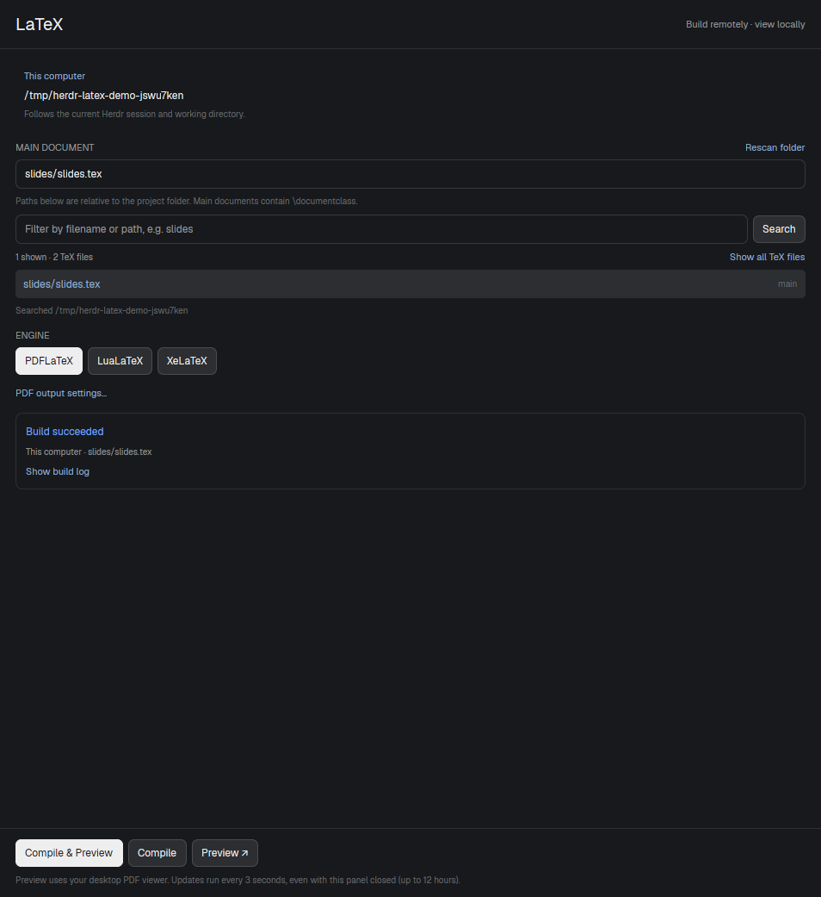

# Herdr LaTeX

A LaTeX panel for [Herdr](https://herdr.dev). Compile in your current local or
remote session, then preview an automatically updated local PDF in your desktop
viewer. No remote filesystem mount or embedded PDF reader is needed.



## Install

Ask your Herdr coding agent:

```text
Read ~/.config/herdr-app/AGENTS.md, then install the mod from
https://github.com/paperbenni/herdr-latex.
Add a LaTeX button to my current Herdr toolbar so I can open the panel with one click.
Read RECIPE.md and all the files before installing. Clone any shipped layout or
toolbar mod before changing it, and preserve my other customizations.
```

The repository uses Herdr's community mod format: `mods/latex/`, `RECIPE.md` and
`preview.png`. The installer agent should copy the mod, check it, and connect a
toolbar button to `run("mod.open", { name: "latex" })`. A personal layout is not
bundled, so installation can fit your existing layout.

For the activity indicator, copy `mods/latex/toolbar-button.js` into your personal
toolbar mod as `latex-button.js`, import its default View, and mount it using
`cx.new()` in the toolbar's `init` method. Render the returned entity as a child.
The component handles opening the panel, green active styling and the play symbol;
see [RECIPE.md](RECIPE.md) for an integration example.

For a manual install, copy `mods/latex` into `~/.config/herdr-app/mods/latex` without
overwriting an existing mod. Then run:

```sh
herdr-app check ~/.config/herdr-app/mods/latex
herdr-app do mod.open --name latex
```

## Use

1. Focus the Herdr session containing your project, then click **LaTeX**.
2. Select the main document found in the current working directory. Click the
   document card to choose a different file. Main files
   containing `\documentclass` appear first; included chapter files can be shown too.
3. Click **Compile & Preview**. The PDF opens only after compilation succeeds.

The panel follows the active session's machine and live working directory. Use
Herdr's existing navigation or `cd` to change projects. Document and engine
preferences are remembered per machine and folder.

The toolbar button turns **green with ▶** while a build or preview update session
is active. It keeps showing activity when the panel is closed. When the helper
stops updating, or polling stops and no build is running, the button returns to
its normal appearance.

- **Compile only** (hammer icon) runs `latexmk` and exposes the build log.
- **Preview** opens an existing PDF without compiling and checks for updates every
  three seconds. A changed PDF is downloaded in full and atomically replaces the
  same local file. An interrupted or incomplete download keeps the previous PDF.
- The **refresh icon** checks immediately; the **stop icon** ends polling.
  Icon controls have hover labels.
- **Build settings** contains the engine selector and an optional custom PDF
  path such as
  `build/slides.pdf`. The compiler's output location remains controlled by your
  LaTeX project configuration.

Your viewer provides zoom, text selection, search and links. Its automatic reload
behavior determines how it responds when the local PDF is replaced. SyncTeX
editor integration is not included.

## Requirements and access

Tested with Herdr 0.1.12 on Linux. The code also selects macOS's `open` launcher,
but macOS has not been tested. Windows is not supported.

- **Local computer:** Python 3, `hc`, a PDF viewer, and `xdg-open` on Linux
  or `open` on macOS.
- **Machine doing the build:** Python 3, `latexmk`, and the selected engine
  (`pdflatex`, `lualatex` or `xelatex`).
- **Remote work:** a connected machine in Herdr. Discovery, compilation, metadata
  checks and binary PDF transfers all use that existing connection through
  `hc exec --on`. The mod does not start SSH or need a separate SSH-agent setup.
- **Optional:** Git speeds up discovery and respects project ignore rules.

This is trusted mod code. It reads TeX sources and PDFs in your working folder,
runs commands and transfers through `hc`, writes a temporary
local PDF, and launches your default viewer. LaTeX builds can also execute the
project's existing `latexmk` configuration. It does not store SSH passwords or
upload your documents to a service.

Builds are limited to ten minutes. Preview helpers survive panel closure and stop
after twelve hours without a button action. PDF downloads are limited to 250 MiB.
PDFs are transferred as exact binary 4 MiB chunks, below Herdr's 8 MiB per-command
output limit. Discovery uses Git's tracked and untracked file lists when available,
respecting ignore rules. Outside Git, a Python scan follows directory symlinks
safely and skips hidden, cache, dependency and build folders. Searches report
partial results at 2,000 matches or 10,000 directories, with a two-second fallback
budget or up to three seconds for Git discovery.
Narrow the filename filter or `cd` into a more specific directory when needed.

Session files and build logs live under the installed mod's `.runtime/` directory.
The local PDF lives in a private OS temporary directory. These files and Herdr's
generated typings are excluded from this repository.

## Development

The runtime sources are `mods/latex/main.js`, `helper.py` and `mod.json`.
The panel's small monochrome SVG icons live in `mods/latex/icons/`.
See [RECIPE.md](RECIPE.md) for the interface and integration behavior.

```sh
herdr-app check ./mods/latex
python3 -m unittest discover -s mods/latex/tests -v
node --test mods/latex/tests/test_context.cjs mods/latex/tests/test_toolbar.cjs
```

The Python integration tests additionally need local `latexmk`, `pdflatex`, and
`pdfinfo`. The JavaScript context tests use Node's built-in test runner; Node is
not required to run the installed mod.
