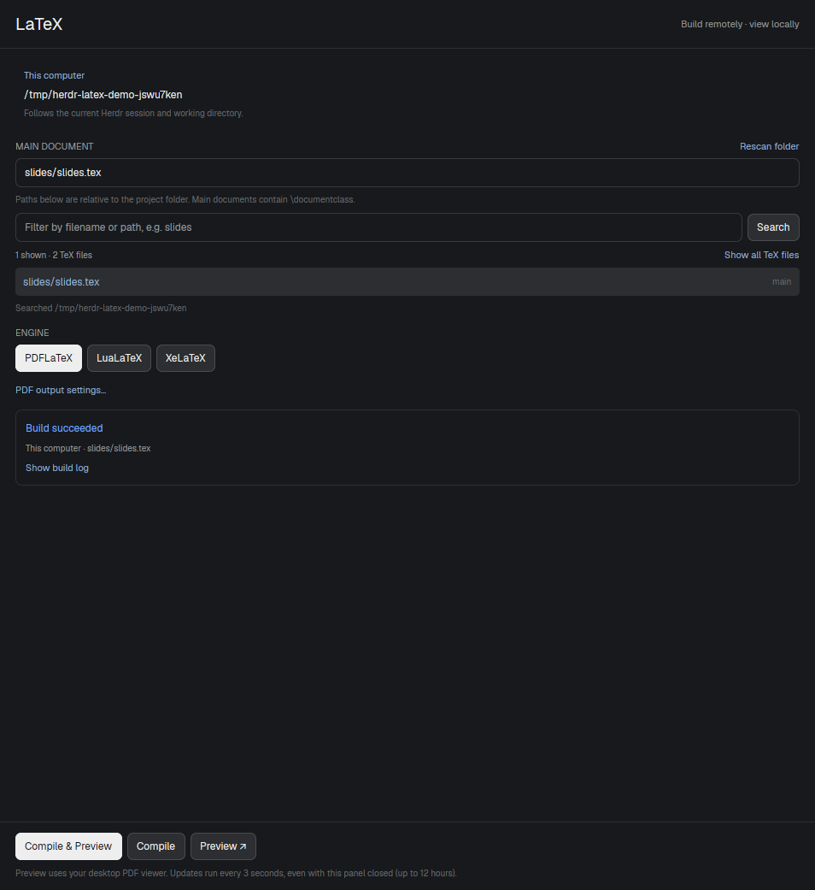

# Herdr LaTeX

A native LaTeX panel that follows the current Herdr session. Choose a document,
compile on that session's machine, and open an automatically refreshed temporary
PDF in the local desktop viewer. Add a LaTeX toolbar button during installation.



## What you see

- A 620 by 760 logical-pixel overlay with a fixed header, scrolling body and fixed
  action footer. Its colors follow Herdr's theme. The title is 20 px; controls
  use 12 px text, and secondary labels use 10–11 px.
- A read-only machine and working-directory card at the top. There is no separate
  machine, project or folder selector.
- A main-document input and automatically discovered TeX files. Main documents
  containing `\documentclass` are shown first; a link reveals included TeX files.
- A filename/path filter, Search button, result count, searched directory and
  explicit notices for incomplete scans or unreadable directories.
- PDFLaTeX, LuaLaTeX and XeLaTeX engine buttons; a collapsed custom-PDF-output
  setting; build/preview status; refresh and stop controls for an active preview;
  and a collapsible monospace build log.
- Footer buttons: **Compile & Preview**, **Compile**, **Preview ↗**. These remain
  visible when the body scrolls. Buttons requiring a document are disabled until
  a document is selected, and build buttons are disabled while that build runs.

## How it behaves

Opening the panel searches the current session's live working directory. Focusing
another session or changing its directory updates the source and starts a fresh
search. Prefer the focused terminal's live cwd; fall back to a live pane in the
active tab, then the space folder. Do not take the first terminal in the space:
different tabs may be in different repositories.

Remember document, engine and PDF output per machine and folder. Automatically
select a main document if exactly one is found. Clicking a file selects it without
hiding the other results. Typing filters loaded results immediately; Search or
Enter scans the folder using that filename/path filter. Rescan explicitly refreshes
the list. Discard results that arrive after the source changed.

Compile runs `latexmk` on the selected session's machine, changes into the source
file's directory, emits synchronization data, and records the build output.
**Compile & Preview** starts the viewer only after a successful build. Failed
builds show their exit state and expand the log; never open an older PDF as if
that failed build succeeded.

Preview downloads an existing PDF into a private temporary directory, opens the
stable local path with the OS viewer, and checks upstream metadata every three
seconds. Changed PDFs are downloaded to a partial file, checked for stability and
PDF markers, and atomically replace the local copy. Unchanged files are not
transferred. Missing PDFs or broken connections retain the previous local copy
and retry. Stop ends polling without closing the viewer. Refresh checks now.

Helpers continue when the overlay closes or reloads, for at most twelve hours
without a button action. Idle helpers stop after ten minutes. Show which source
an existing preview belongs to if the current session has changed. Builds and
preview status are independent of agent working/blocked/done/idle states; this
panel does not draw an agent list or animate those states.

## Built from

Install only `mods/latex/` from this repository. It contains a GPUI `View` in
`main.js`, a standard-library Python helper in `helper.py`, a `mod.json` with
`place: none`, keyboard focus opt-in and 620×760 overlay dimensions, usage notes,
and regression tests. Do not install generated typings, bytecode or `.runtime`.

Use `gpui-kit`'s View/div and `gpui-base`'s flex builders and InputState/Input.
Herdr APIs used include `focused`, `spaces`, `panes`, `shared`/`setShared`,
`readTextFile`, `exec`, `nextCommand`, `appHome`, `home`, and `theme`. Live context
changes cause renders; defer input changes out of render rather than polling
Herdr's live model. A two-second timer reads helper status, not session data.

The Python CLI resolves remote SSH targets using `hc machine ls --json`.
Compilation uses `hc exec --on ... --timeout 600`; scans and downloads use SSH
with batch authentication. Local work uses Python subprocesses directly. A worker
per configuration uses an exclusive file lock, a JSON request queue, atomically
written status, and an upgrade marker so idle workers can load new helper code.
Viewer launch uses `xdg-open` on Linux or `open` on macOS.

Connect a visible **LaTeX** button in the person's existing toolbar to:

```js
run("mod.open", { name: "latex" });
```

Clone shipped layouts and toolbar mods before editing. Preserve existing personal
layout changes. In Herdr's default layout, the `brand` block's `workspace-chrome`
mod draws the upper-left toolbar; clone that mod, add a text button, and reference
the clone from a personal layout. Stop mouse-down propagation on the button so a
click does not drag the window. `mod.open` toggles the overlay. There is no bundled
layout or keybinding to replace the person's setup, and no image assets are needed
by the mod itself.

## Watch out

- This code runs programs, reads project files and uses the network through SSH.
  Tell the person before installing, as Herdr's mod guide requires.
- Unix hosts only. Local Python uses `fcntl`; Windows is unsupported. macOS's
  launcher is implemented but has not been tested.
- Herdr 0.1.12 is the tested API version. Read the installed type declarations if
  native builders differ on another version.
- The machine needs Python 3, `latexmk` and the chosen engine on its PATH. The
  local desktop also needs Python 3, `hc`, SSH, an OS opener and a PDF viewer.
- A remote Herdr connection does not replace SSH credentials or a working SFTP/
  shell SSH target. Downloads use normal SSH configuration, known hosts and agent.
- Search has no depth limit and guards against symlink cycles. It excludes hidden
  directories and common dependency/cache folders, and explicitly reports limits
  of 2,000 matches, 10,000 visited directories or eight seconds. Filtering is a new
  remote search, not just a search of the truncated prefix.
- The optional PDF override changes the downloaded file, not compiler flags.
  Relative PDF overrides are relative to the current working directory; the
  default is next to the selected TeX file.
- Updates download the entire changed PDF; there is no block-level rsync.
  Downloads are limited to 250 MiB. Viewer auto-reload is viewer-dependent.
- Text selection, search, links and zoom are supplied by the external viewer.
  SyncTeX editor integration is not implemented.
- Native mod checks do not exercise all later async states. Also open the panel
  and inspect search results, errors, a build, and preview updates in Herdr.

## Done when

1. The toolbar button opens and closes the panel with one click.
2. A focused remote terminal sets the correct machine and live cwd, even if its
   space was originally created elsewhere; switching session or `cd` updates it.
3. A project with `paper/main.tex` and `slides/slides.tex` lists both main documents,
   supports filename filtering, and reports any truncation.
4. A real temporary LaTeX project builds successfully, while a broken project
   reports failure and does not launch a preview through Compile & Preview.
5. Preview opens a temporary local path; a later upstream edit updates that same
   local path. An incomplete or interrupted replacement keeps the previous PDF.
6. Stop ends polling, and closing/reopening the panel can still control its helper.
7. `herdr-app check mods/latex`, the Python suite and the Node context tests pass.
